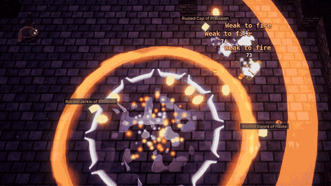
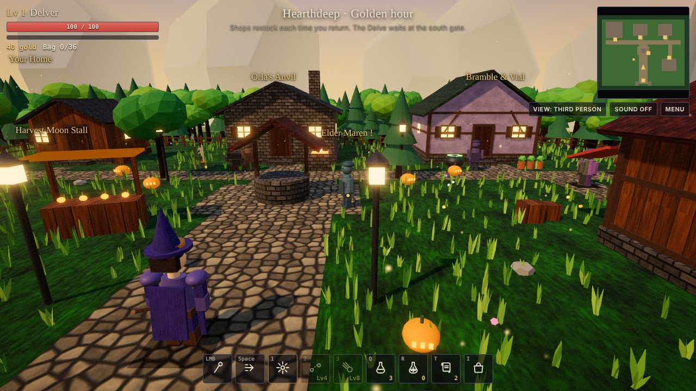
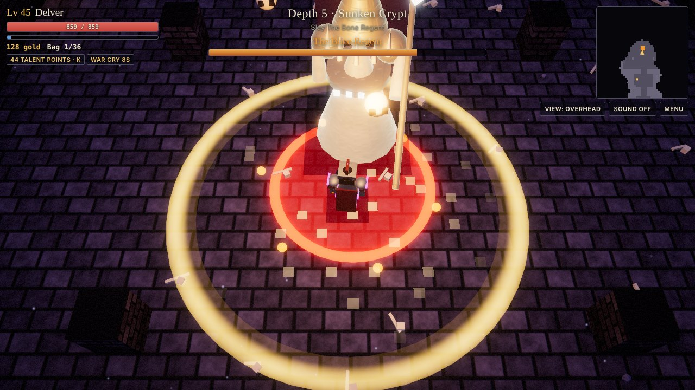
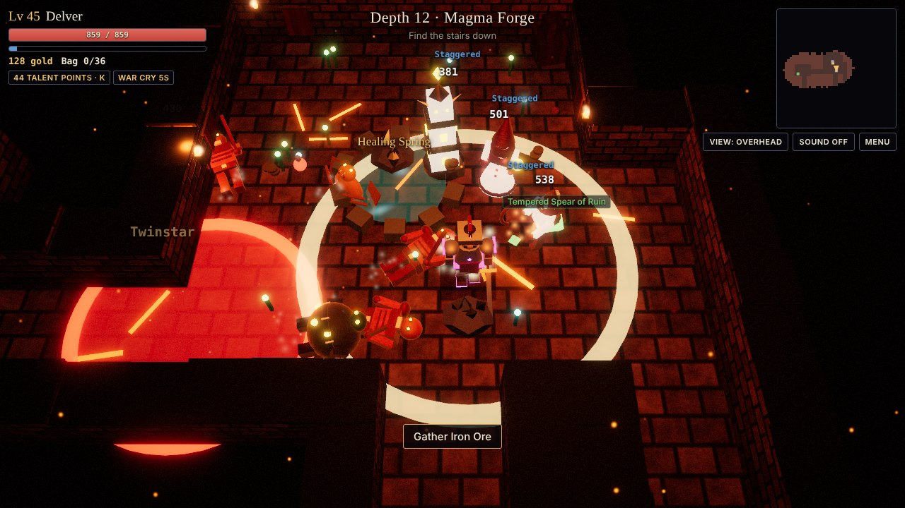
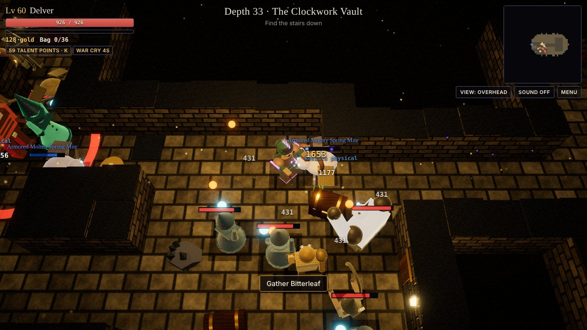
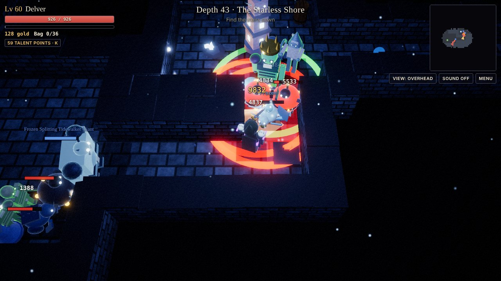
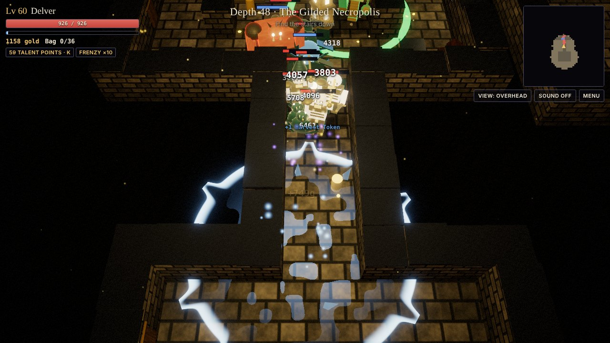

<div align="center">

# Hearthdeep

**A free 3D action RPG that runs in your browser.** A village sits on the lip of a hole with no bottom: delve through endless procedurally generated floors, bring loot home, craft at your bench, and grow your shack into a keep.

### [▶ Play now](https://cptnope.github.io/JAT-Dungeon-Crawler/)

No download, no account. Keyboard and mouse, gamepad or touch. Installs to a phone's home screen and plays offline.

[](https://github.com/CptNope/JAT-Dungeon-Crawler/actions/workflows/ci.yml)

[](https://cptnope.github.io/JAT-Dungeon-Crawler/)

</div>

| | | |
| --- | --- | --- |
|  |  |  |
|  |  |  |

## The short version

- **Endless dungeons.** Ten biomes of five depths each, then round again, harder. Rooms, corridors, traps, shrines, cursed altars, treasure vaults and a boss every fifth floor.
- **Four classes.** Warrior, Ranger, Mage and Necromancer, each with three skills and a nine-talent tree, then Paragon levels past 60.
- **100 enemy types.** Ten behaviours across ten biomes, champions with affixes, named pack leaders, two-phase bosses and five Rift Guardians.
- **Loot worth chasing.** Five rarities, sets, gems and sockets, sixteen legendary powers, Ancient and Primal gear, crafting, upgrades and imprinting.
- **A home to build.** House, workbench, garden, kennel, trophy hall and a yard, in a village with a day and night cycle, weather and seasonal festivals.
- **Three ways to look at it.** Overhead, third person and first person, switchable at any moment.
- **Race your friends.** Every rift has a code. Copy a challenge link and anyone who opens it plays the same floors and the same foes; there is a daily seed and a weekly rift for everyone.
- **Built for everyone.** Colour-blind palettes, four interface sizes, reduce-motion, three difficulties, full key rebinding and screen-reader roles.

It is about 7,300 lines of plain JavaScript on [three.js](https://threejs.org/) r186 with no other dependencies and no build tooling beyond a shell script. Every texture, model, sound effect and piece of music is generated in code; the repository holds no art or audio files beyond the app icons.

## Play

**In the browser:** <https://cptnope.github.io/JAT-Dungeon-Crawler/>

**Challenge a friend:** at the Delve, open Rift Trials and press *Copy challenge link*. The link looks like `https://cptnope.github.io/JAT-Dungeon-Crawler/?rift=HD-4-SB-1A2B3C`; whoever opens it finds the same rift waiting for them. Pasting a whole message into *Play a code* works too.

**Host it yourself:** any static host works (GitHub Pages: Settings → Pages → deploy from `main`, root). Locally, ES modules need a server:

```bash
python3 -m http.server 8000   # then open http://localhost:8000
```

`dist/hearthdeep.html` is a single self-contained file that loads three.js from jsDelivr instead of `vendor/`.

**Install it on a phone**: the hosted `index.html` ships a web app manifest and a service worker, so on GitHub Pages it can be added to the home screen ("Install app" or "Add to Home Screen") and then runs full screen and offline. Each build stamps a new cache version, so an update replaces the old copy on the next visit.

<details>
<summary><b>Controls</b></summary>

Every key below can be rebound in **Settings → Controls** (arrow keys, Shift and F keep working too).

| Input | Action |
| --- | --- |
| WASD / arrows | Move |
| Mouse | Aim (overhead) or look (third and first person; click to capture the mouse) |
| Left click (hold) or J | Attack (three-hit combo; the third swing is a heavy finisher) |
| Space, Shift or right click | Roll (brief invulnerability) |
| 1 / 2 / 3 | Your class's three skills (unlock at levels 1, 4 and 8) |
| Tab or middle click | Lock on to the nearest foe / cycle targets |
| X | Release lock-on |
| E | Use, open, talk |
| V | Switch view: Overhead → Third person → First person |
| Mouse wheel | Zoom (overhead and third person) |
| Alt (hold) | Show the names of common items on the ground |
| Q / R | Healing Draught / Greater Draught |
| T | Portal Scroll (opens a way home) |
| I | Bag, materials, character sheet |
| K | Talents |
| C | Codex: achievements, story, bestiary, records, run card, save backup |
| P | Photo mode (orbit, lens, filters, capture) |
| Esc | Menu |
| `` ` `` or F3 | Performance readout |
| Gamepad | Left stick moves, right stick aims or looks; A attack, B roll, X use, Y draught; LB / RB / LT skills; R3 or d-pad left lock on; d-pad up greater draught, down portal scroll, right view; Start menu, Back bag. In menus the d-pad moves, A presses, B closes, LB / RB change tabs |
| Touch | Left stick moves; drag the screen to look in close views; Strike aims for you (it sticks to your target and prefers foes in the direction you push); skill, lock and utility buttons around the thumbs; short vibrations on hits, level-ups and boss kills |

</details>

<details>
<summary><b>Everything in it</b> (the long list)</summary>

- **Necromancer**, the fourth class: Raise Skeletons (two at a time, up to four, fighting for 20 seconds), Bone Spear (pierces every foe in a line) and Corpse Explosion (every fallen foe nearby bursts; fallen foes glow green for 12 seconds). Heals 2% on every kill. Nine talents of its own: Grave Pact, Bone Armor, Soul Siphon, Legion, Marrow, Plague, Lich Form, Undying, Reaper.
- **Depths 41 to 50**: past the Hollow King lie the Starless Shore (black sand, glowing tide pools; the Drowned Moon) and the Gilded Necropolis (gold and marble; the Gilded Sovereign), each with ten foes of its own, new materials, ambience and resistances.
- **New boss attacks**: Ripple (rings of blows with a turning gap), Chase (blows fall where you stand, again and again) and Cross (a plus, then an X), used by the new bosses and added to the Bone Regent, Ashmaw and the Rime Halls boss.
- **New rooms**: treasure vaults with three chests, one of them a Mimic with a hoard inside, and overgrown groves with a healing spring. Flooded rooms in the Magma Forge are lava, and it burns.
- **Paragon**: levels stop at 60; past it, experience earns Paragon levels, each a point for Might, Vigor, Swiftness or Fortune (moved freely, Bag → Paragon). Heroes already past 60 keep every extra level as Paragon.
- **Ancient and Primal gear**: from item level 32, legendaries and set pieces can drop Ancient (30% stronger); from 45, rarely Primal (50% stronger, one extra affix). Higher rift tiers raise the odds. A Runeforge can Awaken any legendary into an Ancient one with the new deep materials.
- **Rift Guardians**: five of them (Warden of Hours, Maw of the Rift, the Many-Eyed, Riftwyrm Matriarch, the Unmade Knight), each with its own look and boss attacks.
- **Seasonal festivals**: in November it's the Harvest Moon: gourd lanterns around the village, Harvest Tokens from foes, 10% more experience, and a festival stall trading caches, an Elixir of Plenty, essence and a Gourd Lantern for your yard. Frostfall (December) and Hallows' Eve (October) are set up the same way.
- **Spell effects**: shader-drawn fire, frost, lightning and bone novas; forked lightning bolts that flicker; ice spikes that erupt and melt; spells briefly light the dungeon around them. Water ripples and catches light; lava churns under a cooling crust. Your gear shows on your hero: crests and brow bands on fine helms, glowing trims on fine armour, lit soles on epic boots, a halo when three pieces are Ancient.
- **Online (on the published claude.ai page only)**: Menu → Online. A Weekly Rift leaderboard and a Deepest Descent board for everyone who can open the page; your weekly time is sent with a ghost of your run, and in the Weekly Rift you race the fastest ghost (or one you pick) as a pale figure on the same floors. **Parties**: start one and share its five-letter code; you see each other walking the village and inside the same seeded rift, anyone can call the party into a rift, and finishing times are announced to everyone. Each player fights their own foes; enemies are not shared between players. Names are shown as each viewer's claude.ai sees them, and only ids are stored. None of this exists on a plain web host, where the game stays single-player.

- **Settings** (menu → Settings): view, graphics, a battery saver (30 fps cap, low resolution), look speed, music, vibration and the loot filter; **Accessibility**: red-green and blue-yellow safe palettes (rarity colours and the enemy warning colour, with rarity letters on every item), four interface sizes, reduce motion (no shake, hit-stop, slow motion, lens kicks or lightning flashes), and difficulty; **Controls**: rebind any key. The HUD, panels, toasts and death screen carry screen-reader roles and live regions.
- **Difficulty** (per hero, change any time): Story (much softer foes, no gold lost on death), Normal, Hard (tougher foes, 30% more experience, 40% more magic find).
- **Builds**: item names float over loot on the ground; the loot filter salvages Common (or Common and Uncommon) gear into essence the moment you pick it up, never sets or legendaries; three **loadouts** in the Bag save your gear and talents and swap them in one press (bag gear anywhere, stash gear and talents in town).
- **Skill legendaries**: eight more legendary powers change what every skill does: Maelstrom Sash (skills drag foes in), Earthshaker Greaves (rolls end in a shockwave), Horn of the Old Guard (stacking damage after each skill), Quiver of Ash (seeking ember-bolts), Tempest Crown (lightning strikes), Rimewalker Band (skills chill everything near you), Ring of Embers (a ring of fire circles you), Twinstar Seal (skills can come straight back).
- **Extract and imprint**: with an Artificer's Table, extract a legendary at the Workshop to learn its power for good, then imprint any learned power onto rare or epic gear for essence, sigils and gold.
- **Presentation**: boss title cards with letterboxing, a slow flyover of the village behind the title menu, loading tips between floors, credits, biome ambience (drips, spore pops, magma rumble, ice wind, void whispers, clockwork ticking, a heartbeat in the Bloodroot) and birds or crickets in town, footsteps that change with the ground underfoot.

- **Three views**: angled overhead, over-the-shoulder third person with wall collision, and first person with a held weapon. Dungeon walls rise to full height in the close views. Change view with V, the View button, or the menu.
- **Graphics**: golden-hour town with sun shadows, sky dome and image-based light; torch-lit dungeons where the lantern casts shadows and the nearest wall torches flicker as real lights; HDR bloom, ACES tone mapping, colour grade and vignette; procedurally generated stone, brick, cobble, grass, wood, shingle and plaster textures with normal maps; wind-blown grass, biome particles (dust, spores, embers, snow, void sparks) and torch flames; arm and leg animation for every creature. High, Medium and Low quality presets, with automatic step-down on slow devices.

- **Combat feel**: hit-stop and camera shake on heavy blows (shake can be turned off), three-hit combos with real swing animations, weapon trails, shockwave rings, flinch and stagger, corpses that topple and sink, lock-on targeting with camera framing, FOV kick on rolls and dashes.
- **Classes**: pick Warrior, Ranger, Mage or Necromancer for a new hero (older saves are asked once and keep their gear). Each has its own perks and three skills:
  - Warrior: Whirlwind, Leap Slam, War Cry
  - Ranger: Volley, Shadow Dash, Rain of Arrows
  - Mage: Ember Nova, Blink, Meteor
  - Necromancer: Raise Skeletons, Bone Spear, Corpse Explosion
- **Talents**: one point per level, spent across a three-tier tree of nine talents per class (block, evasion, executioner, multishot, ricochet, overflow and more). Elder Maren unlearns them for a fee.
- **Set items and gems**: three three-piece sets with two- and three-piece bonuses drop in place of some legendaries. Rare and better gear can roll sockets, and you can drill more at the workshop. Five gem types in three cuts drop from foes and chests; fuse three into the next cut.
- **Dungeon events**: spike traps, shrines (Fury, Stone, Fortune, Haste, Life) that bless the rest of the run, and cursed altars that summon three ambush waves guarding a rich chest. Rooms are dressed with barrels, crates and biome-coloured banners.
- **Quests**: Elder Maren by the well offers three tasks each visit (slay a kind of foe, hunt leaders or champions, reach a depth, gather materials, silence an altar, fell a boss) for gold, essence, experience and gear; the active task shows under the minimap.
- **Music**: a procedural score — town chords, a drone per biome, and a driving rhythm for boss fights (toggle in the menu).
- **Story**: Elder Maren tells an eight-chapter tale as you slay each biome's keeper, sixteen pages of Aldric's journal lie in the deep, and the first time you reach depth 40 the last keeper is the Hollow King, with an ending. The deep goes on after it.
- **Elements and combos**: weapons hit physical (staves arcane); Ember Nova and Meteor burn, Blink freezes, Rain of Arrows is lightning. Every biome resists some elements and fears others. Chill a chilled foe to freeze it; a critical or heavy hit shatters a frozen foe; fire on a chilled foe is a thermal shock; lightning on a burning foe overloads.
- **Perfect rolls and parries**: roll through a blow at the last moment, or swing into an enemy's strike as it lands, for a guaranteed critical (and, for rolls, a moment of slow motion and shorter cooldowns).
- **Sharing**: a run card image of your hero and records, a photo mode, and rift seed codes (a daily code everyone shares, or any code a friend sends). On a web host a code travels as a challenge link (`?rift=HD-4-SB-1A2B3C`) that leaves the rift waiting at the Delve for whoever opens it.
- **Rift Trials**: three-floor timed runs from the Delve with one to three modifiers (Swift, Brutal, Horde, Elite, Glass, Lightless, Volatile, Draining, Frenzied) and a Rift Guardian sealing the last floor. Beat par to unlock the next tier and double the rift shards.
- **Weekly Rift**: the same seeded floors and modifiers for everyone each week, with your best time recorded.
- **The Pit**: endless arena waves that grow deeper, with a pack leader every fifth wave and a Pit Champion every tenth; leave between waves to keep your winnings, and falling there costs no gold.
- **Sabine's Caravan**: turns up in the village now and then with set pieces, a legendary, socketed gear, gems and sealed caches, paid in gold or rift shards.
- **Themed rooms**: libraries lined with shelves, flooded halls that slow you, chasms crossed by bridges, columned halls, and tombs of stone coffins.
- **Bosses with their own silhouettes**: orbiting skulls, a mushroom cap, horns and embers, an ice crown, a void halo, tentacles and coral, turning gears, antlers of bark.
- **Weather**: rain with thunder, fog and snow in the village, on top of the day and night cycle.
- **Game feel**: a light pillar and summary on level up, a slow-motion moment and pillar of light when a boss falls, loot beams for rare drops, gear comparison that shows exactly how each stat would change, a death recap (what killed you, floors, foes, gold, time) with a tip, and first-time hints for new players (can be turned off in the menu).
- **Overworld town**: Orla's Anvil (gear, restocks every trip), Bramble & Vial (draughts, scrolls, elixirs), Copper Lantern (materials, buys anything), and your Home.
- **Upgradable home**: House (Leaky Shack → Hearth Keep; stash size and Rested bonus), Workbench (recipe tiers, upgrade cap), Garden (herbs and essence each return), Kennel (a hound, then a dire wolf, that fights beside you), Trophy Hall (permanent bonuses per boss slain). The house model changes as you build.
- **The yard**: lantern posts, flower beds, banners in your class colours, a training dummy, a fountain and a statue of you, each with a small bonus.
- **A living village**: a six-minute day and night cycle with stars, fireflies and lamplight, and villagers who walk the paths and stop to talk (about you, your depth and your dog).
- **Progression**: three save slots, 28 achievements, a bestiary of every foe and boss by biome, a hall of records for your best descents, and a save code you can copy out and import on another device.
- **Endless dungeon**: rooms-and-corridors generation with a flow field for enemy pathing. Ten biomes of five depths each, then round again with rising difficulty: Sunken Crypt, Fungal Hollows, Magma Forge, Rime Halls, The Hollow Rift, The Drowned Deep, The Clockwork Vault, The Bloodroot Warren, The Starless Shore, The Gilded Necropolis.
- **100 enemy types**: 10 behaviours (melee, charger, archer, caster, swarm, bomber, summoner, shield-bearer, leaper, warding totem) × 10 biomes, plus 10 champion affixes (Swift, Vampiric, Splitting, Explosive…), named **leaders** with Frenzy/Ward/Rally auras that buff their pack, and a two-phase **boss** every fifth depth with its own attack patterns (the deep three add whirlpools, breaking waves, turning beams and racing roots). Bosses open waypoints.
- **Loot**: 7 weapon types (melee arcs and ranged projectiles), 6 slots, 5 rarities, 13 affixes, 16 legendary powers (chain lightning, flame nova, spectral blades, phoenix, and the eight skill legendaries above).
- **Crafting**: draughts, portal scrolls, elixirs, forging rare/epic/legendary gear for a chosen slot, upgrades to +10, affix rerolls, salvage into essence.
- Progress saves in the browser (localStorage).

</details>

## Development

Edit the files in `src/`, then run `./build.sh`. The built `game.js`, `index.html`, `sw.js` and `dist/hearthdeep.html` are committed, so GitHub Pages serves the repository as it is.

```bash
./build.sh                      # assemble the game from src/
python3 -m http.server 8000     # play it at http://localhost:8000
node tools/smoke-test.mjs       # headless check (needs: npm i --no-save playwright && npx playwright install chromium)
./tools/package-itch.sh         # dist/hearthdeep-itch.zip, ready to upload to itch.io
node tools/capture-media.mjs tools/capture-scenes.json   # press screenshots and GIF frames, bot at the controls
```

Every push and pull request runs the build and the smoke test in GitHub Actions; the build step fails if the committed build is out of date with `src/`.

`vendor/three.module.js` and `vendor/three.core.js` are the official three.js r186 builds minified with esbuild (`esbuild three.core.js --minify --format=esm --legal-comments=inline`), which cuts the engine download from about 417 KB to about 196 KB compressed.

### Layout

```
src/            game source (edit these)
  1-data.js     items, affixes, enemies, biomes, recipes, home upgrades, stats
  1b-meta.js    classes, talents, sets, gems, the deeper biomes, achievements
  2-render.js   renderer, quality presets, HDR post-processing, procedural textures, materials, sky, particles
  3-world.js    creature, hero and weapon models, first-person viewmodel, level generation
  3b-visuals.js dungeon and town construction, torch lights
  4-entities.js enemies, AI, bosses, projectiles, telegraphs, combat, loot
  4b-feel.js    hit-stop, shake, corpses, weapon trails, rings, lock-on, portals
  4c-juice.js   first-time hints, level-up moment, gear deltas, boss dressing
  5-game.js     level flow, player, camera modes, minimap, saving
  5b-depth.js   skills, traps, shrines, altar ambushes, quests
  5c-audio.js   sound effects and the procedural music sequencer
  5d-class.js   class skills, ground effects, the companion
  5e-town.js    day and night, weather, villagers, yard decorations
  5f-modes.js   rift trials, weekly rift, the Pit, the caravan
  5g-story.js   chapters, journal pages, dialogue, the Hollow King and the ending
  6b-meta-ui.js class choice, talents, gems and sockets, yard, codex, save slots and export
  6c-pad.js     gamepad play and menu navigation
  6d-share.js   run card, photo mode, rift seed codes
  4d-vfx.js     shader spell effects, lightning, ice, spell light, water and lava, gear on the hero
  5h-endgame.js Paragon, Ancient and Primal gear, Rift Guardians, seasonal festivals
  6e-settings.js settings, accessibility palettes, difficulty, key bindings, credits
  6f-online.js  leaderboards, ghosts and parties (claude.ai capabilities; absent elsewhere)
  sw.js         offline cache for the hosted build (version stamped by build.sh)
  6-ui.js       HUD and all panels (shops, home, crafting, bag)
  7-main.js     input, look controls, title menu, loop, adaptive quality, boot
  head.html / body.html
build.sh        assembles game.js, index.html, sw.js and dist/hearthdeep.html
tools/          autoplay bot, headless smoke test, press capture, itch.io packaging
press/          press kit: fact sheet, screenshots, gameplay GIF, share image
manifest.webmanifest, icons/   installable web app
vendor/         three.js r186 (MIT, see THREE-LICENSE)
```

### Testing

`tools/autoplay-bot.js` is an autoplay bot used for testing: paste it into the browser console on a running game, then call `startBot('mage', [['delve', 1, 120], ['rift', 2, 90], ['pit', 0, 60]])` (each phase is a mode, a depth or tier, a number of seconds and an optional level to raise the hero to). It fights, drinks, explores, takes stairs and seals rifts while logging errors, softlocks, deaths and frame times; `botReport()` prints the result and `stopBot()` hands the controls back. `hearthdeep.debug.DBG.turbo` runs extra simulation steps per frame to speed it up. Every class was run headless through delves, rifts, seeded rifts, the Pit and the depth-40 finale before release.

Saves keep a backup copy and are repaired on load (bad numbers, broken items, missing fields); if the main copy is damaged the backup is restored.

## Performance work

Applied from the `threejs-performance` skill in [CloudAI-X/threejs-skills](https://github.com/CloudAI-X/threejs-skills), measured with `renderer.info` (press `` ` `` in game):

| Technique | Where |
| --- | --- |
| **Merge static geometry** per material | Town props are baked into one mesh per material (`bakeStatic`); each creature kind is merged once and the geometry shared by every creature of that kind (`makeCreature`). A creature is 2–3 draw calls instead of 6–9. |
| **Instancing** | Floors, walls, wall caps, torches, flames, trees and biome decoration are `InstancedMesh`es with per-instance colour. |
| **Fewer triangles** | Floor tiles are single quads (2 triangles) instead of boxes (12). |
| **Static transforms** | Baked and instanced scenery uses `matrixAutoUpdate = false`. |
| **No transparent double-sided draws** | Attack arcs are single-sided; telegraph and projectile materials are cached and reused. |
| **No allocations in the loop** | Pooled particles, attack arcs and floating numbers; shared steering vector; emissive colours set in place. |
| **Animated but merged characters** | Arms, legs and capes swing in the vertex shader from per-creature uniforms (limb tags baked into the merged geometry), so animation adds no draw calls. |
| **GPU particles** | Bursts are one `Points` object; ambient motes and torch flames animate entirely in the vertex shader from a time uniform. Contact shadows are one instanced quad. |
| **Shadows only where they matter** | The sun casts shadows in town only; the lantern casts them in dungeons only (High). A small pool of torch lights is reassigned to the nearest torches instead of one light per torch. |
| **Shared world materials** | Floor, wall and town materials are created once and recoloured per biome, so changing floors needs no shader rebuild. |
| **Shader compile stalls** | `renderer.compileAsync(scene, camera)` warms every program (including effect materials) before a new floor's first frame. |
| **Fill rate** | Pixel ratio capped at 2 and adapted at runtime: it steps down when frames average over 24 ms and back up when there's headroom. |
| **Loop** | `renderer.setAnimationLoop` with `THREE.Timer` connected to the document (pauses in hidden tabs). |

Draw calls are counted across every render pass in a frame (shadow maps, scene, bloom). Foes past the fog are not drawn, and only foes near the lantern cast shadows. Typical counts in headless testing on High: 70–150 in dungeons overhead (the lantern skips its shadow pass when seen from above), 150–280 in the close views with a room full of foes, about 120 in town.

## Balance

Enemy scaling was tuned against a simulated climb (one pass from depth 1, killing most of each floor, wearing rare gear of the current depth, no talents, gems or upgrades). With those assumptions a normal foe takes one or two hits to kill early and three to five by depth 40, a player survives about 25 hits from a common foe at depth 1 and about nine at depth 37, and a boss takes 15 to 25 seconds of plain attacks to kill up to depth 25. Talents, sets, gems and upgrades are the margin for going deeper. Past depth 25 an extra ramp builds steadily instead of jumping at once.

## Press and sharing

The [press kit](press/) has a fact sheet, screenshots, the gameplay GIF and the share image. Screenshots and footage of the game are free to use in articles, videos and streams.

## Credits

Made by [Jeremy Anderson](https://jeremyanderson.tech/) ([@JAndersonTech](https://x.com/JAndersonTech)). Built on [three.js](https://threejs.org/) (MIT, see `vendor/THREE-LICENSE`). Performance techniques from [CloudAI-X/threejs-skills](https://github.com/CloudAI-X/threejs-skills).
